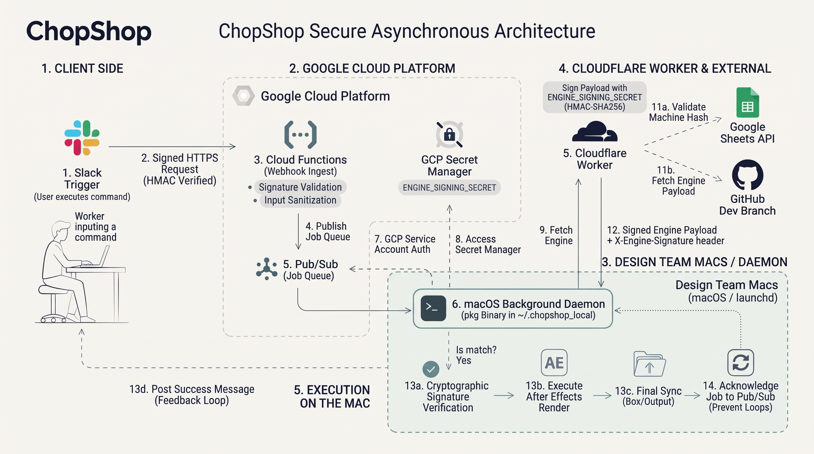

# ChopShop: Secure Asynchronous Architecture

> **Automated, Cryptographically Verified Data Injection and Rendering for Video Design Systems**

`ChopShop` is a hardened, headless macOS background service that powers automated After Effects template injection. It operates on a zero-trust model—pulling jobs from GCP Pub/Sub, dynamically verifying payloads with HMAC-SHA256 signatures, and executing renders invisibly in the background via macOS `launchd`.

This repository hosts the sanitized background daemon (`daemon_core.js`), the render engine (`chopshop.js`), and the zero-touch deployment script (`install.sh`).



---

## 🏗️ Architecture Overview

1. **Client Trigger (Slack):** A designer triggers a render command via Slack.
2. **Webhook Ingest (GCP Cloud Functions):** Validates Slack's HMAC signature, sanitizes user inputs, and publishes the job payload to the queue.
3. **Job Queue (GCP Pub/Sub):** Decouples Slack from rendering and prevents runaway retry loops via explicit message acknowledgments.
4. **Signed Payload Delivery (Cloudflare Worker):** Validates the requesting machine's hardware hash against Google Sheets, pulls the latest render engine from GitHub, and signs the payload using `ENGINE_SIGNING_SECRET`.
5. **Background Execution (macOS Daemon):** A dependency-free `pkg` binary running via `launchd` in `~/.chopshop_local/`. It fetches `ENGINE_SIGNING_SECRET` from GCP Secret Manager, verifies the payload signature, executes the After Effects render in an isolated sandbox, syncs outputs to Box, and posts a completion update back to Slack.

---

## 🚀 Setup & Compilation

### 📋 Prerequisites
- **macOS** with Adobe After Effects installed in `/Applications`
- **Node.js 18+** (required on the build machine only)
- **GCP Project** with Cloud Functions, Pub/Sub, and Secret Manager configured

### 🔨 1. Compile the Daemon Binary
Bundle `daemon_core.js` into standalone macOS executables so end-users do not need Node.js or `npm` installed:

```bash
npm install -g pkg
npx pkg daemon_core.js --target node18-macos-arm64,node18-macos-x64 --output chopshop-daemon
```

### 📥 2. Zero-Touch Team Deployment
Package the compiled binary (`chopshop-daemon`), your GCP Service Account JSON (`chopshop-daemon-key.json`), and `install.sh` into a ZIP archive for your team.

Designers install the service without administrator (`sudo`) privileges by running:

```bash
chmod +x install.sh
./install.sh
```

This installs the files to `~/.chopshop_local/` with restricted permissions (`0700`/`0600`) and registers `com.chopshop.daemon` with macOS `launchd` so it starts automatically on login.

---

## 🔒 Security & Resilience

- **No Hardcoded Secrets:** Cryptographic keys (`ENGINE_SIGNING_SECRET`) are retrieved dynamically at runtime from GCP Secret Manager.
- **Cryptographic Verification:** The macOS daemon verifies the `X-Engine-Signature` header (HMAC-SHA256) before executing any engine code.
- **Permissionless User-Space Install:** Runs entirely within `~/.chopshop_local/`, avoiding system directory modifications or `sudo` prompts.
- **Loop Protection:** Explicit Pub/Sub message acknowledgments and delivery attempt limits prevent failed jobs from triggering infinite retry loops.
